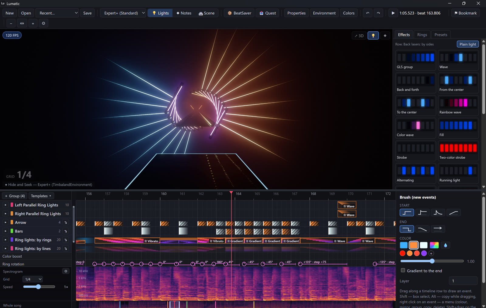
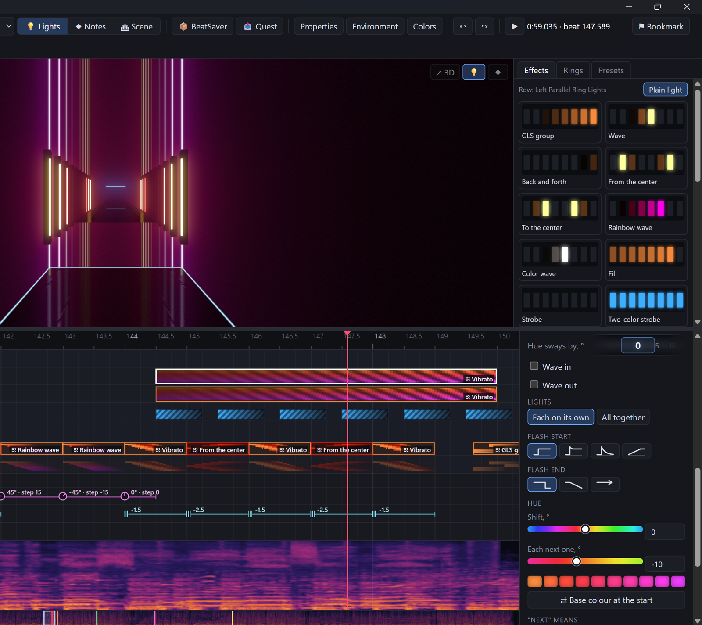
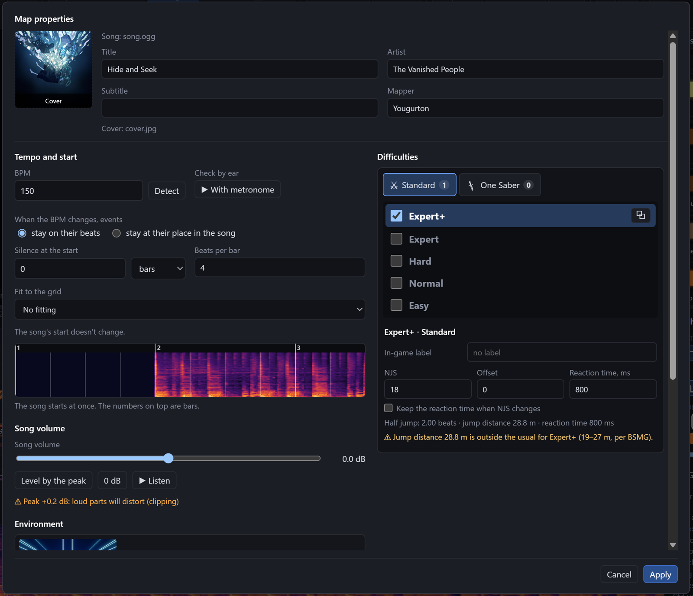
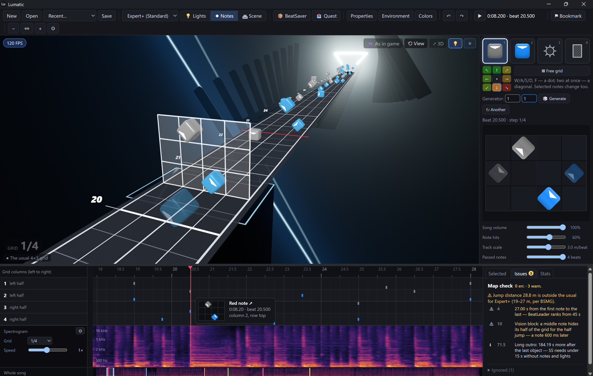

# Lumatic

**A standalone desktop editor for Beat Saber maps, lighting, and Chroma environments.**

Lumatic brings a timeline-first lighting workflow, practical beatmap editing tools, and a 3D environment editor into one application. Create and arrange lighting effects against the music, organize environment lights by ID, edit notes and obstacles, and preview your work in a live 3D scene.

> **Development status:** Lumatic is in active beta development. Features, workflows, and supported map data may change between versions. The `dev` branch is the current development branch.

[](docs/images/lumatic-showreel-poster.jpg)

*The lighting workspace with the timeline, Light ID groups, and live 3D preview. Click any screenshot to view it at full size.*

## Why Lumatic?

Lumatic is built around a simple idea: complex Beat Saber lighting should be easier to create, understand, and edit.

Instead of relying on a 3D timeline where the mapper constantly moves around the environment, Lumatic uses a flat, layered timeline inspired by video and motion-graphics editors. The 3D viewport remains available for visual feedback and scene editing, while the timeline is the main workspace for arranging and shaping a lightshow.

Lumatic is a standalone desktop application built on the ChroViewer rendering and beatmap technology, with editor workflows developed specifically for Beat Saber mapping and lighting.

## Features

### Lighting timeline

- **Timeline-first workflow.** Place, move, trim, copy, and arrange lighting clips directly against the song.
- **Procedural effects.** Create patterns such as waves, fills, strobes, gradients, flicker, pulses, twinkles, and fire-like motion by adjusting effect parameters.
- **Editable effects.** Effects remain adjustable after placement instead of becoming an opaque, one-time generated result.
- **Layered lighting.** Put effects on separate layers so overlapping patterns can combine — for example, a persistent base light with a moving colour wave above it.
- **Light ID organization.** Select individual environment lights and organize them into groups and nested subgroups.
- **Visual group identification.** Selecting a group or individual Light ID highlights its lights in the 3D preview.
- **Reusable structures and presets.** Save group layouts, effect presets, and selected map regions as templates.
- **Live 3D preview.** Scrub or play the song and see the lighting result in the environment.

[](docs/images/02-lighting-timeline.png)

### GLS, rings, and lasers

- Create and edit Group Lighting System (GLS) groups and events.
- Configure supported filters, distribution, timing, brightness, transitions, and easing.
- Edit ring poses and ring zoom.
- Build ring and laser movement patterns with dedicated controls.
- Preview supported lighting and environment animation in 3D.

### Audio and timing tools

- Import common audio formats, including MP3, WAV, FLAC, OGG, and M4A.
- Read song and map metadata.
- Estimate BPM and the first beat, then refine the beat grid.
- Find and adjust the downbeat.
- Listen with metronome clicks to check beat alignment.
- Inspect audio using a spectrogram and frequency-band analysis.
- Prepare map audio as Ogg Vorbis and add leading silence when needed.
- Use audio analysis as part of the lighting workflow.

Audio analysis provides tools and signals for editing; it does not automatically create a finished lightshow.

[](docs/images/04-audio-tools.png)

### Beatmap editing

- Edit notes, bombs, walls, arcs, and chains.
- Work with map objects on a timeline synchronized to the song.
- Draw, select, move, copy, and adjust objects.
- Use note-generation helpers to suggest playable patterns.
- Split long walls into shorter segments with configurable spacing or density.
- Select map regions and reuse selected content as templates.
- Review potential mapping issues with configurable checks.
- Jump from a reported issue to the affected part of the map.

The checks draw on guidance from the Beat Saber Mapping Wiki (BSMG), BeatLeader, and ScoreSaber. They help identify potential problems; they do not guarantee ranking approval.

[](docs/images/05-mapping-workspace.png)

### 3D environment editor

Lumatic includes a dedicated scene-editing workspace for Chroma environment modifications.

- Browse, search, and select objects in the scene hierarchy or 3D viewport.
- Move, rotate, and scale objects with transform gizmos.
- Hide, duplicate, and restore scene objects.
- Create custom primitive geometry.
- Configure supported materials and lights.
- Arrange objects in editable arrays and patterns.
- Parent objects and use supported track relationships.
- Animate supported object transforms and material properties with keyframes.
- Edit animation timing, curves, and easing.
- Adjust supported environment properties.
- Validate scenes for common issues, including missing objects, obstructed play space, Light ID conflicts, and unused materials.
- Import and export supported Chroma environment files.

The environment editor aims to provide a direct, scene-oriented workflow instead of requiring every change to be made through raw JSON.

### Game environment support

- Browse the environments included with Lumatic.
- Use ready-made custom Chroma environments bundled with the project, subject to their individual terms and attribution requirements.
- Point Lumatic to a local Beat Saber installation to inspect and convert additional game environments.
- Keep converted environment data in the user's local Lumatic data folder; it is not added to maps automatically.
- Preview available environments in the 3D viewport.

Lumatic does not distribute a copy of Beat Saber or bundle the user's game installation. Environment conversion uses files from the user's own installed game. The optional converter requires Python, UnityPy, and Pillow; see [scripts/game-environments.py](scripts/game-environments.py).

### Map workflow and Meta Quest

- Open and edit local Beat Saber map folders.
- Work with map metadata, difficulties, audio, and environment settings.
- Manage maps in the built-in map library.
- Prepare BeatSaver-compatible map archives, with checks for missing referenced files and common packaging issues.
- Send maps to a connected Meta Quest headset using ADB over USB or supported wireless workflows.
- Discover and pair devices using Android wireless debugging.
- Use an existing ADB installation or download Android platform-tools through the application.
- Upload to supported WIP or custom-level folders.

## Beat Saber formats and mod ecosystem

Lumatic works with standard Beat Saber beatmap data and supported custom data used by the modding community.

| Format or mod | Current role |
|---|---|
| Beat Saber v2 | Supported map format. |
| Beat Saber v3 | Supported map format and current target for many modern lighting workflows. |
| Beat Saber v4 | Can be opened/viewed, but complete editing and writing support is not implemented. |
| Chroma | Custom lighting, environment modifications, materials, and related map data. |
| Noodle Extensions | Supported track relationships and animation data used by environment workflows. |
| Heck / GLS | Group Lighting System and related lighting workflows. |

Maps that use mod-dependent features still require the corresponding mods in Beat Saber. Lumatic does not install those mods into the game.

**Format note:** Lumatic currently saves v2 and v3 maps. v4 support is incomplete. When a workflow depends on lighting or custom data that cannot yet be written to v4, use a v3 copy.

## Screenshots

The screenshots above show the current editor in action. Additional captures will be added as the interface evolves.

## Technology

| Area | Technology |
|---|---|
| Desktop runtime | [Electron](https://www.electronjs.org/) |
| Application language | [TypeScript](https://www.typescriptlang.org/) |
| Renderer development and build | [Vite](https://vite.dev/) |
| 3D rendering | [Three.js](https://threejs.org/) |
| Rendering and beatmap foundation | [ChroViewer](https://github.com/Umbranoxio/chroviewer) |
| Electron bundling | esbuild |
| Windows packaging | electron-builder, Inno Setup |
| Audio encoding | Web Audio API and WebAssembly encoders |
| Game environment conversion | Python, UnityPy, Pillow |
| Quest communication | Android Debug Bridge (ADB) |

Other direct dependencies include `troika-three-text`, `zod`, `fflate`, `lzma-web`, `better-result`, and `use-intl`. The full dependency list and third-party licensing information are maintained in `package.json` and [THIRD_PARTY_NOTICES.md](THIRD_PARTY_NOTICES.md).

## Getting started

### Download

When public builds are available, download the Windows installer or app package from [GitHub Releases](https://github.com/Yougurton/Lumatic/releases).

The online installer downloads the official Electron runtime during installation rather than bundling it into the Lumatic application payload. See [Windows online installer](docs/online-installer.md) for details.

### Run from source

**Requirements**

- Node.js 22 and npm.
- Git.
- Windows is the currently configured desktop packaging target.
- Python, UnityPy, and Pillow are needed only for the optional game-environment conversion workflow.

Clone the repository and install dependencies:

```powershell
git clone https://github.com/Yougurton/Lumatic.git
cd Lumatic
git switch dev
npm ci
```

Start the renderer development server:

```powershell
npm run dev
```

Build and launch the desktop application:

```powershell
npm run build
npm start
```

### Useful commands

| Command | Description |
|---|---|
| `npm run dev` | Start the Vite development server. |
| `npm run typecheck` | Run the TypeScript type checker. |
| `npm run build` | Build the renderer and Electron main/preload bundles. |
| `npm start` | Build and launch the application with Electron. |
| `npm run dist:app` | Build the app-only Windows distribution payload. |
| `npm run dist:win:online` | Build the app payload and Windows online installer. |
| `npm run release:check` | Check release readiness and source state. |
| `npm run dist:source` | Create a source archive. |

For the complete Windows installer and release process, see [docs/online-installer.md](docs/online-installer.md).

## Project structure

```text
electron/       Electron main process, preload bridge, file access,
                updates, map library, ADB / Quest integration
src/editor/     Editor UI and application logic:
                timeline, lighting, GLS, notes, environment,
                audio, map library, settings and presets
src/engine/     3D renderer and Beat Saber environment / lighting engine
public/         Static assets and built-in environment data
scripts/        Environment conversion and release / packaging tools
tests/          Automated tests
```

The Electron main process mediates filesystem access through a preload API. The renderer does not receive unrestricted Node.js access; map and system operations go through the application's controlled bridge.

## Roadmap

Lumatic is actively evolving. Areas being explored or planned include:

- **More procedural lighting tools:** expand the effect system and make complex effects easier to customize and reuse.
- **Audio-assisted lighting:** develop tools that suggest useful lighting events from musical structure while keeping the mapper in control of the final result.
- **Deeper environment workflows:** expand scene editing, animation, and support for more environment features.
- **Broader format compatibility:** continue improving support for Beat Saber map formats and modded data, including the v4 writing path.
- **Workflow refinement:** improve map editing, previews, presets, and quality-of-life tools based on mapper feedback.

Roadmap items are plans, not release commitments. Scope and priorities may change during beta development.

## Current limitations

- Beat Saber v4 maps can be opened, but complete v4 editing and writing support is not yet available.
- Some Chroma environment materials and shaders may be approximations in the preview; check important results in Beat Saber itself.
- Chroma environment export does not yet preserve every feature of the editor's internal scene and animation model.
- Support for mod-specific features varies; maps may still require the corresponding Beat Saber mods.
- Lumatic is in beta. Keep backups of maps while testing development builds.

## Credits and third-party content

Lumatic builds on [ChroViewer](https://github.com/Umbranoxio/chroviewer), which provides rendering and beatmap/environment technology.

The project also includes or references third-party libraries, environment data, and assets. Their authors and license terms are documented in:

- [THIRD_PARTY_NOTICES.md](THIRD_PARTY_NOTICES.md)
- `public/custom-envs/licenses/`
- [public/custom-envs/README.md](public/custom-envs/README.md)

Please check the relevant terms and attribution requirements before reusing bundled environments or assets. Beat Saber and its game assets belong to their respective rights holders. Lumatic is an independent community project and is not affiliated with or endorsed by Beat Games.

## Contributing and feedback

Bug reports, reproducible examples, and workflow feedback are welcome. When reporting a rendering or map-compatibility issue, include:

- Lumatic version and operating system.
- Beat Saber version and environment name.
- A short description of the expected and actual result.
- Relevant logs or a minimal map/project example, when it is safe and legal to share.

Please do not upload or commit extracted Beat Saber game assets, converted environment bundles, or other copyrighted game files.

## License

Lumatic is licensed under **GNU General Public License v2.0 only (GPL-2.0-only)**. See [LICENSE](LICENSE) for the full license text.

Third-party libraries and bundled assets may have separate licenses or usage terms; see [THIRD_PARTY_NOTICES.md](THIRD_PARTY_NOTICES.md) and the relevant asset license files.
